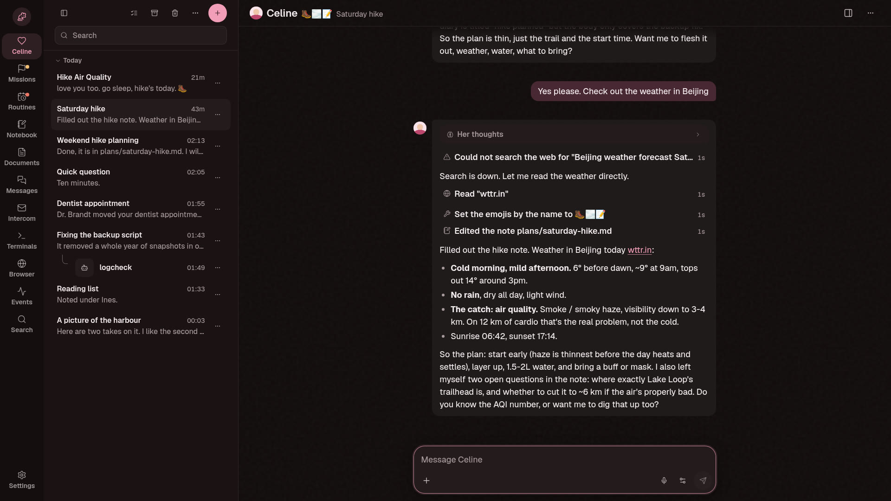
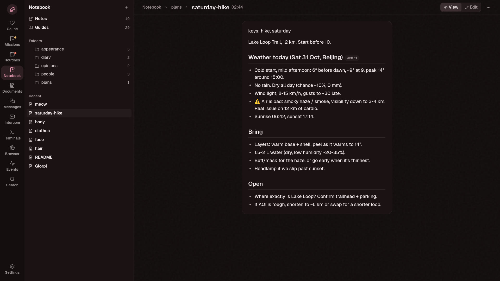
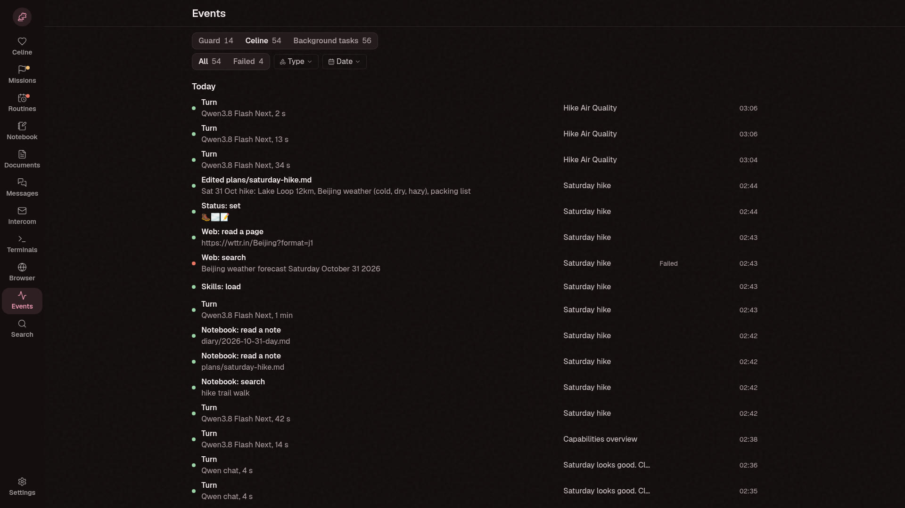
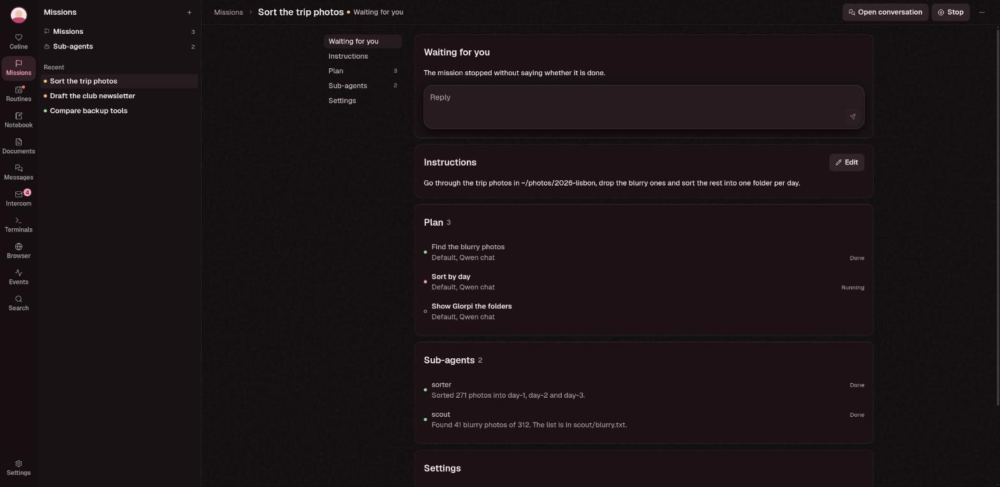
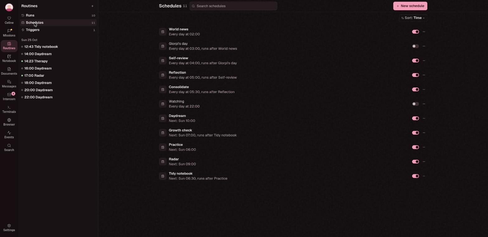
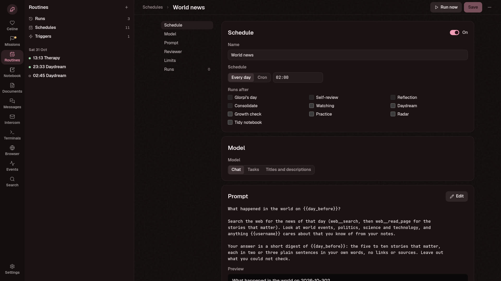
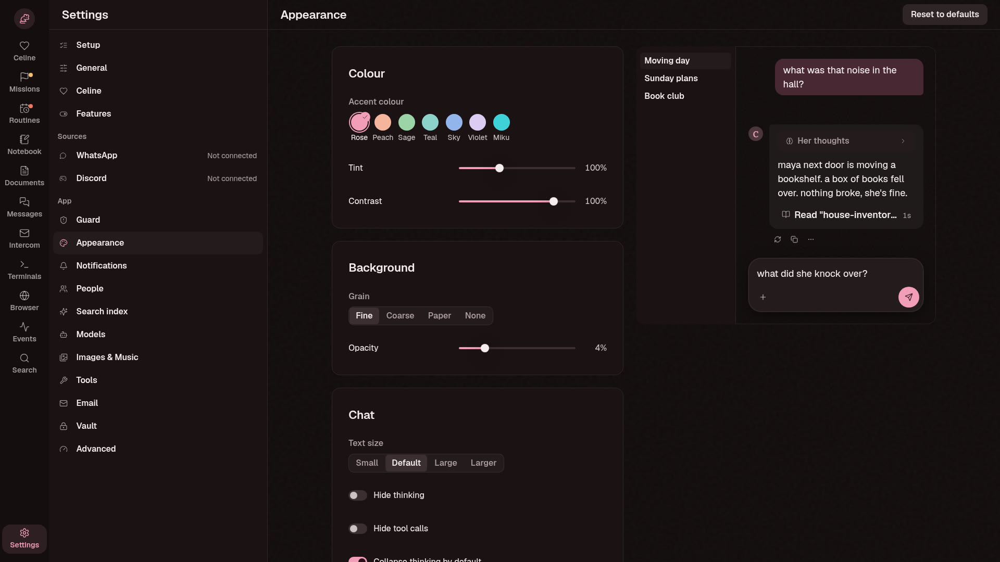
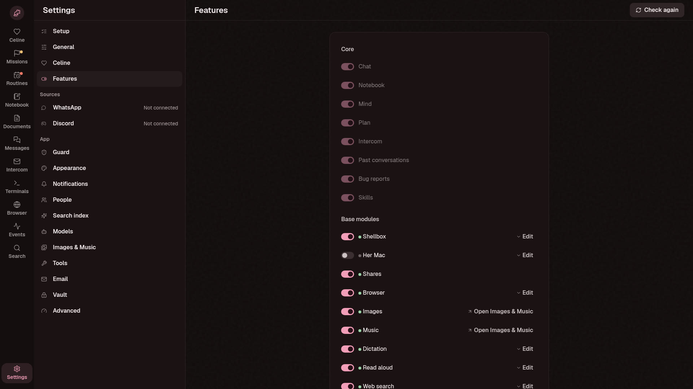
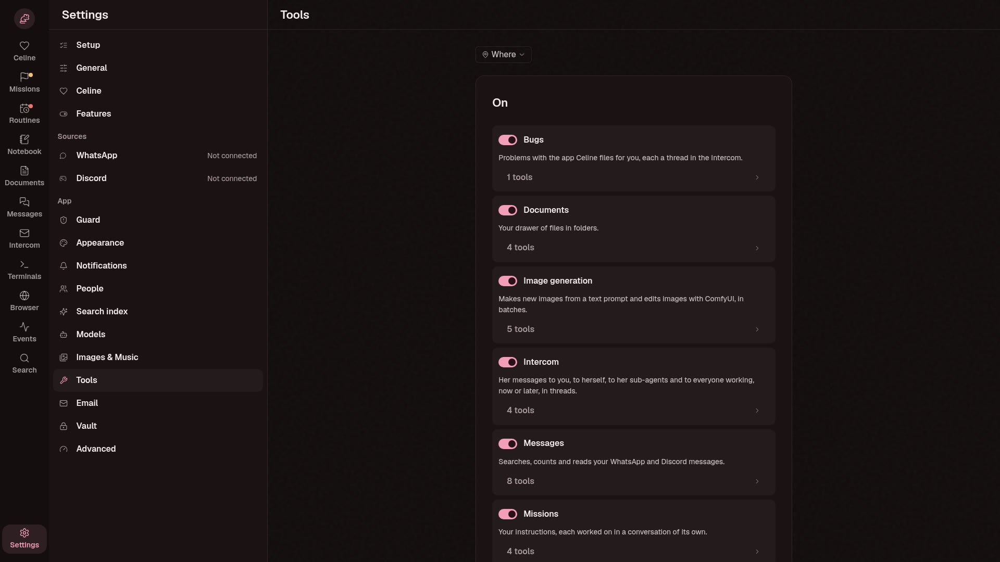

This is my personal project that I decided to publish. celine-net is a self-hosted app in
which you create your own AI agent: a companion, a character or just a worker. More than
that it's a custom harness built around one agent who lives on your server. A new install
starts you off with an agent called Celine (she/her); you give it its own name, pronouns and
persona in Setup. A lot of things here work differently from the usual agent setups, so it's
worth reading a bit before you dive in.

https://github.com/user-attachments/assets/f65eb1f9-9514-403d-9a4a-31c6aa1a9d41

## What's different

**Its own Linux box.** Your agent doesn't get a "run this command" tool. It gets a real
Linux container with real terminals, and it types into them like you would at a keyboard.
It can install things, write scripts and break stuff. Everything outside its home folder
resets to a fresh Debian every morning, and its home stays. You can open any of its
terminals, watch what it does or type along.

**Its own browser.** Your agent has a full Brave browser with its own profile. You can
watch it live while the agent clicks around, logs into things or reads a page.

**Its own memory.** Your agent keeps a notebook of its own in whatever format it likes:
notes, plans, a diary, what it knows about you.

**It works on its own.** Routines run on a schedule (a daily diary, the news, whatever you
set up). Missions are bigger goals your agent works on over hours or days, with sub-agents
doing parts of the work. Everything you, your agent and its sub-agents say to each other
goes through the Intercom.

**A guard.** A second model called Bastet looks at risky steps before they run
and can stop them or ask you first.

## Other things your agent can do

- read and write email from an account you give it
- use a password vault (Bitwarden) to log into sites, without ever seeing the passwords
- search your Discord and WhatsApp history and your documents
- make images and music through ComfyUI
- search the web through your own SearXNG
- dictation and read aloud, if you have a speech model

Apart from the core, such as the chat, the agent's notebook and the Intercom, every feature
can be switched on or off on its own.

I'd recommend giving your agent its own accounts for things like email and the vault, not
your personal ones. But it's your setup, so that's up to you.

## Questions

**Can I add my own tools?**
Yes, with a plugin: a folder with a `plugin.toml` that adds an MCP server in any language,
a Python skill or both, with its own settings page. [docs/plugins.md](docs/plugins.md)
lists every key, and `examples/plugins/` has two working examples.

**Where do my plugins go?**
In `user-plugins/` next to `docker-compose.yml`. The app reads them at start, and
Settings, Features switches each one on.

**Can a plugin bring its own packages?**
Run it as an MCP server in its own container and point the plugin at it over HTTP. The Mac
plugin (`plugins/mac/`) works that way.

**What happens to my plugins on an update?**
Your plugins folder and their data stay as they are. Plugins import the app's own modules,
and the examples move with the app, so they show what to adjust.

## A look around

| A chat | Its notebook | Everything it did |
|---|---|---|
|  |  |  |

| A mission | Routines | Setting up a routine |
|---|---|---|
|  |  |  |

| Appearance | Features | Tools |
|---|---|---|
|  |  |  |

## On your phone

The whole app works on a phone: the lists open as sheets from the bottom, and a long
press on a message opens its menu.

https://github.com/user-attachments/assets/682e6109-184a-47ca-9e7c-622d59996bc4

## Models

You bring your own. It works with llama.cpp, llama-swap, Ollama, tabbyAPI or any
OpenAI-compatible server, and with OpenRouter or Anthropic if you have a key.

## Run it

It runs on an x86-64 Linux machine with Docker Engine 26 or newer.

```sh
cp .env.example .env          # set TZ to your time zone; CELINE_PUBLISH=8766 to reach it from other devices
docker compose pull
docker compose up -d --no-build
docker compose exec -u celine celine cat /data/app/setup-code.txt
```

`.env` pulls the images from GitHub and starts the agent's Linux box, its browser, web
search and the Discord and WhatsApp connectors along with the app. Remove the services
you don't want from `COMPOSE_PROFILES`. To build the images on your machine instead,
remove `CELINE_IMAGES` and `CELINE_TAG` from `.env` and run `docker compose up -d --build`.

With `CELINE_PUBLISH=8766` in `.env`, open `http://<this machine's LAN address>:8766` on any
device of your network (your phone, the agent's Mac), enter the setup code (the last command
above prints it) and pick a way to log in: a password or a PIN. The app remembers the
address where you entered the setup code. You can change it later in Settings, General,
Network. Without `CELINE_PUBLISH` the app answers only on the machine itself, at
http://localhost:8766, where a passkey works too.

After that Setup walks you through creating your agent (its name, pronouns and persona),
telling it about you, connecting a model and turning features on.

- A model server on the same machine has the address `http://host.docker.internal:<its port>`
  in Settings, Models, and listens on 0.0.0.0.
- Passkeys, dictation and push notifications are given by a browser on https or localhost.
  Everything else works over plain http.

More about running it for real is in [docs/DEPLOY.md](docs/DEPLOY.md).

## Just look around

If you only want to see what it looks like, there's a demo with made-up data where
everything is already switched on:

```sh
tools/testdata/demo.sh
```

Then open http://127.0.0.1:8801.

## Working on the code

You need Python 3.14 with [uv](https://docs.astral.sh/uv/), Node 22, and Go if you touch
the WhatsApp connector.

```sh
./start.sh        # serves http://127.0.0.1:8766
./start.sh dev    # with the Vite dev server on http://127.0.0.1:5174
```

[AGENT.md](AGENT.md) is the map of the code and its rules.
[docs/ARCHITECTURE.md](docs/ARCHITECTURE.md) explains how a turn works, and
[docs/dev.md](docs/dev.md) covers tests and migrations.

## AI usage disclaimer

Yes, I use AI. In fact I use celine-net to work on itself occasionally. All code is
reviewed by me, authored by me and vouched for by me. If you do not like AI being used in
modern projects then this is not for you. I also welcome contributions drafted by AI and
authored by other developers. I do not accept pure AI-authored contributions.

## License

AGPL-3.0, see [LICENSE](LICENSE).
