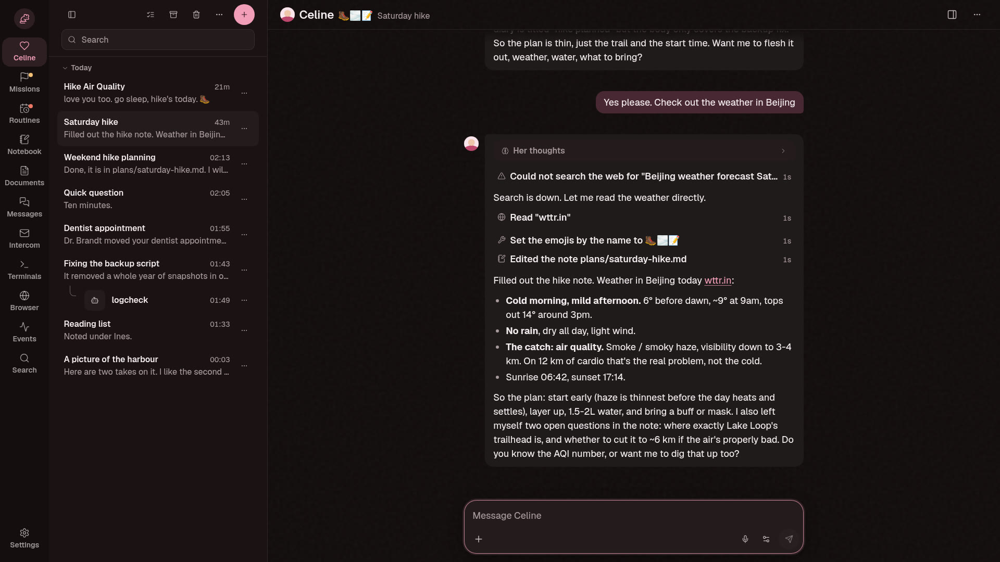
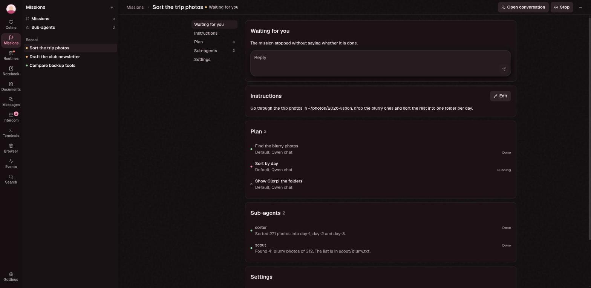
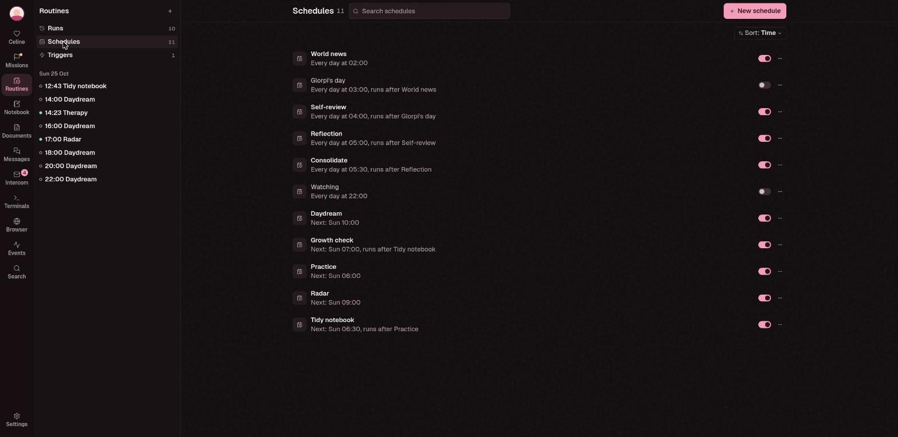
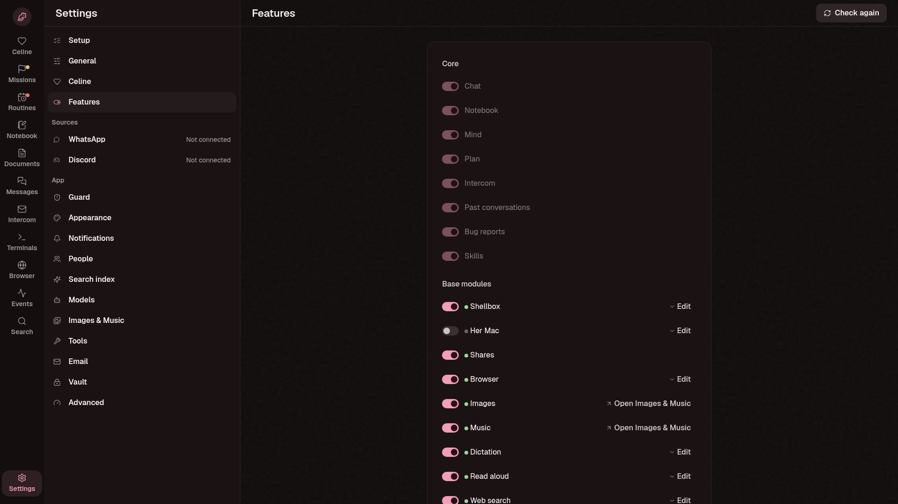

This is my personal project that I decided to publish. Celine is a self-hosted AI agent,
but more than that it's a custom harness built around one agent who lives on your server.
A lot of things here work differently from the usual agent setups, so it's worth reading a
bit before you dive in.



## What's different

**Her own Linux box.** Celine doesn't get a "run this command" tool. She gets a real Linux
container with real terminals, and she types into them like you would at a keyboard. She
can install things, write scripts and break stuff. Everything outside her home folder
resets to a fresh Debian every morning, and her home stays. You can open any of her
terminals, watch what she does or type along.

**Her own browser.** She has a full Brave browser with its own profile. You can watch it
live while she clicks around, logs into things or reads a page.

**Her own memory.** She keeps a notebook of her own in whatever format she likes: notes,
plans, a diary, what she knows about you.

**She works on her own.** Routines run on a schedule (a daily diary, the news, whatever you
set up). Missions are bigger goals she works on over hours or days, with sub-agents doing
parts of the work. Everything you, she and her helpers say to each other goes through one
intercom.

**A guard.** A second, smaller model called Bastet looks at risky actions before they run
and can stop them or ask you first.

## Other things she can do

- read and write email from an account you give her
- use a password vault (Bitwarden) to log into sites, without ever seeing the passwords
- search your Discord and WhatsApp history and your documents
- make images and music through ComfyUI
- search the web through your own SearXNG
- dictation and read aloud, if you have a speech model

Every feature can be switched on or off on its own.

I'd recommend giving her her own accounts for things like email and the vault, not your
personal ones. But it's your setup, so that's up to you.

| A mission | Routines | Features |
|---|---|---|
|  |  |  |

## Models

You bring your own. It works with llama.cpp, llama-swap, Ollama, tabbyAPI or any
OpenAI-compatible server, and with OpenRouter or Anthropic if you have a key.

## Run it

```sh
docker compose up -d
docker compose exec -u celine celine cat /data/app/setup-code.txt
```

Open http://localhost:8766, enter the setup code and pick a login (passkey, password or
PIN). After that the setup walks you through naming her, telling her about you, connecting
a model and turning features on.

The box, the browser, SearXNG and the connectors are optional containers. You turn them on
with compose profiles in `.env`, see `.env.example`. More about running it for real is in
[docs/DEPLOY.md](docs/DEPLOY.md).

## Just look around

If you only want to see what it looks like, there's a demo with made-up data where
everything is already switched on:

```sh
tools/testdata/demo.sh
```

Then open http://127.0.0.1:8801.

## Working on the code

You need Python 3.14 with [uv](https://docs.astral.sh/uv/), Node 22, and Go if you touch
the WhatsApp connector.

```sh
./start.sh        # serves http://127.0.0.1:8766
./start.sh dev    # with the Vite dev server on http://127.0.0.1:5174
```

[AGENT.md](AGENT.md) is the map of the code and its rules.
[docs/ARCHITECTURE.md](docs/ARCHITECTURE.md) explains how a turn works, and
[docs/dev.md](docs/dev.md) covers tests and migrations.

## AI usage disclaimer

Yes, I use AI. In fact I use celine-net to work on herself occasionally. All code is
reviewed by me, authored by me and vouched for by me. If you do not like AI being used in
modern projects then this is not for you. I also welcome contributions drafted by AI and
authored by other developers. I do not accept pure AI-authored contributions.

## License

AGPL-3.0, see [LICENSE](LICENSE).
